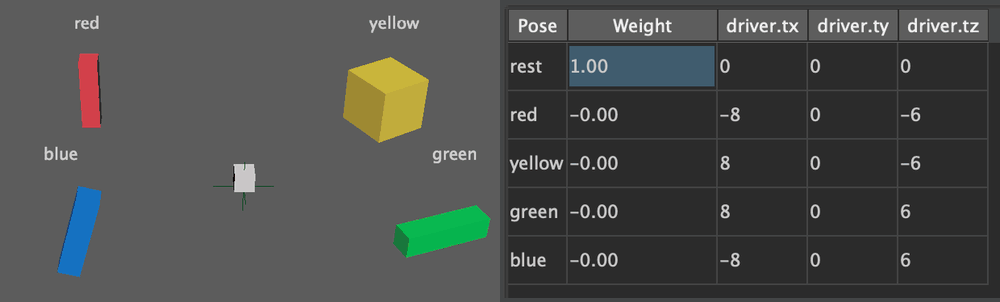
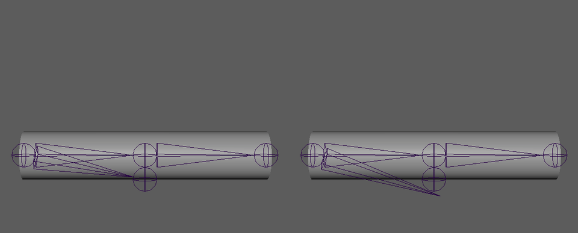
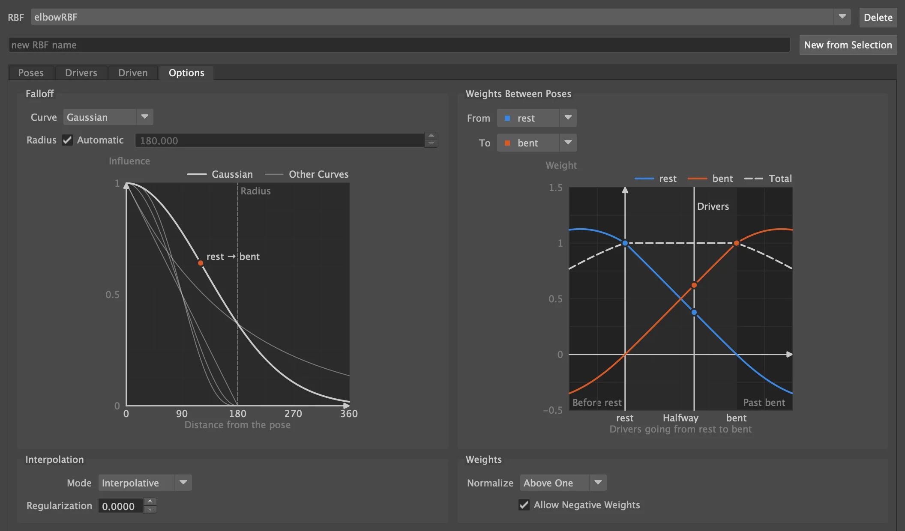
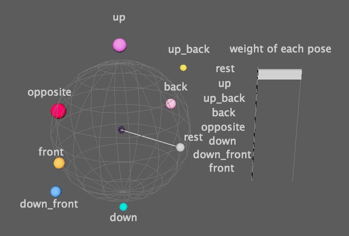
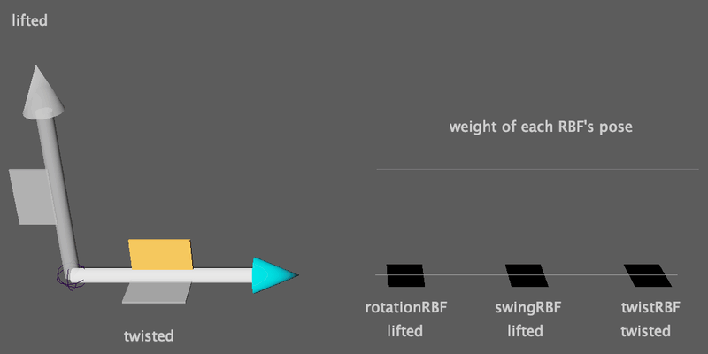

# poseRBF

**poseRBF** is an open-source pose-space RBF for **Autodesk Maya**, evaluated by a
Bifrost graph: drivers (joints and attributes) are compared with example poses, and
each pose's weight blends what it asks for — attribute values, blendShape weights,
joint moves.

What it gives:

- **One node, every result.** Weights, driven values and driven joint moves come
    out of the same graph.
- **Several drivers, several measures.** Rotation, swing, twist, translation and
    numbers, each with its own factor.
- **Self-contained scenes.** Each RBF keeps its graph inside the scene; playing it
    needs Maya and Bifrost, not the tool.

## What it looks like

An elbow without and with a corrective joint driven by its bend:

The window, drawing what the settings do to the poses of the RBF:

| Directions on a sphere                                               | Rotation, swing and twist                                |
| -------------------------------------------------------------------- | -------------------------------------------------------- |
|  |  |

## Features

| Part     | What it covers                                                             |
| -------- | -------------------------------------------------------------------------- |
| Measures | Rotation, swing, twist about any local axis, translation, numbers          |
| Falloff  | Gaussian, exponential, linear, cubic, quintic; a set or automatic radius   |
| Weights  | Interpolative or additive, regularization, normalize, negative weights     |
| Results  | One weight per pose, driven values, driven transforms                      |
| Window   | Poses, Drivers, Driven and Options, docked in Maya; one undo step per edit |
| Python   | Every action of the window as a function                                   |

## Requirements

- Autodesk Maya 2025, 2026 or 2027.
- Bifrost 2.14 or later.

## Installation

Download the zip of the
[latest release](https://github.com/ldecampos/poseRBF/releases/latest), unzip it and
drag `install_poseRBF.py` into a running Maya viewport. It copies the `poserbf`
folder into the Maya scripts folder shared by every Maya version, or into a folder
chosen in its dialog, and adds a **poseRBF** button to the shelf shown. No restart
is needed.

To uninstall, delete the copied `poserbf` folder and the shelf button.

## Documentation

| Start here                                                                                | For                                     |
| ----------------------------------------------------------------------------------------- | --------------------------------------- |
| [A first corrective](https://ldecampos.github.io/poseRBF/tutorials/first-corrective.html) | Riggers: an elbow, step by step         |
| [How-to](https://ldecampos.github.io/poseRBF/how-to/index.html)                           | Riggers: one task per page              |
| [A first script](https://ldecampos.github.io/poseRBF/tutorials/first-script.html)         | Developers: the same elbow, from Python |
| [How an RBF works](https://ldecampos.github.io/poseRBF/explanation/how-it-works.html)     | Anyone: the math, with numbers          |
| [Reference](https://ldecampos.github.io/poseRBF/reference/index.html)                     | The window, the scene, the API          |

## Support and status

**This project is provided as is, with no support and no warranty.**

It is built and maintained in whatever time is left over from a full-time job,
as a personal side project. Please read this before you rely on it:

- **No support is offered.** Issues and questions may go unanswered
    indefinitely. There is no response time, and none is implied.
- **No maintenance is guaranteed.** Bugs may go unfixed, and development may
    pause or stop at any point without notice.
- **No responsibility is accepted** for any outcome of using this software,
    including damage to rigs, scenes or production data. You use it at your own
    risk. Test it on a copy before pointing it at anything you care about.

The MIT license is deliberate: if the project stalls, you are free to fork it,
change it and ship it, commercially or otherwise, without asking anyone.

## Contributing

**Open source, not open contribution.**
Bug reports and ideas are welcome in the issue tracker, and neither carries a
promise that anything will be read, answered or acted on.

If you want a change made, fork it — that is what the MIT license is for.

## License

Released under the [MIT License](LICENSE). Copyright (c) 2026 Luis de Campos.

Use it for anything, including commercial and closed-source work. The only
condition is that the copyright notice and license text travel with copies or
substantial portions of the software.

## Authors

- **Luis de Campos** — [LinkedIn](https://www.linkedin.com/in/luisdecamposmdl/)
