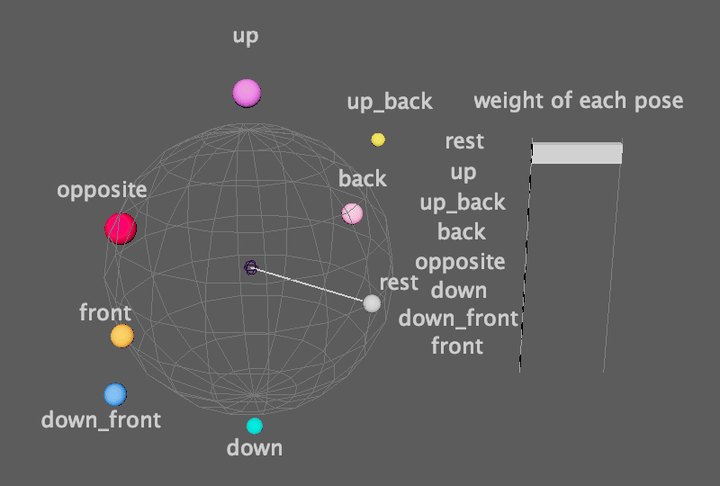

# How an RBF works

A pose RBF (radial basis function) blends results from examples. At a pose, the result
is what that pose asks for; between poses, a blend; far from all of them, rest.



It takes four steps. The example is an elbow with two poses, *straight* at 0 degrees and
*bent* at 90, stopped halfway, at 45.

## 1. Distance

How far the drivers are from each pose. The elbow is 45 degrees from both.

A transform is read through its local `.matrix` and compared by four measures; a number,
by its difference:

| Measure     | Compares                                               | Unit        |
| ----------- | ------------------------------------------------------ | ----------- |
| Rotation    | the whole orientation                                  | degrees     |
| Swing       | where the local axis points; twist about it is ignored | degrees     |
| Twist       | the rotation about the local axis                      | degrees     |
| Translation | the position                                           | scene units |

Each measure is multiplied by its factor and squared; the distance is the square root of
their sum:

```text
distance = √( (factor × difference)² + … )
```

Factors put different units on one scale. Several drivers make one pose out of several
joints, such as an arm raised and an elbow bent at the same time.

## 2. Answer

The distance is divided by the radius, and a curve turns the result into an answer
between 0 and 1. With `x = distance / radius`:

| Curve       | Answer                    | Past the radius |
| ----------- | ------------------------- | --------------- |
| Gaussian    | `e^(−x²)`                 | fades, never 0  |
| Exponential | `e^(−x)`                  | fades, never 0  |
| Linear      | `1 − x`                   | 0               |
| Cubic       | `(1 − x)² (1 + 2x)`       | 0               |
| Quintic     | `(1 − x)³ (1 + 3x + 6x²)` | 0               |

The automatic radius is 1.5 times the average distance from each pose to its nearest
one: 1.5 × 90 = 135. At 45 degrees, `x` is 0.33 and a Gaussian answers 0.895, for both
poses.

## 3. Weight

Answers are not weights yet: with the elbow straight, *bent* still answers 0.641. In
interpolative mode, what each pose answers at every other pose is written in a table,
and the table is inverted:

```text
1.000 0.641                1.698 −1.089
0.641 1.000   inverted:   −1.089  1.698
```

Multiplied by it, the answers become exactly 1 and 0 at the poses:

| Angle | Answers       | Weights       |
| ----- | ------------- | ------------- |
| 0°    | 1.000 / 0.641 | 1.000 / 0.000 |
| 45°   | 0.895 / 0.895 | 0.545 / 0.545 |
| 90°   | 0.641 / 1.000 | 0.000 / 1.000 |

The inverse depends on the poses, not on the animation: it is solved once, when a pose
changes.

- **Regularization** trades the exact match for smoothness when close poses ask for
    opposite results.
- **Additive** mode skips this step and uses the answers as weights.
- **Negative weights** can be set to 0.
- **Normalize** divides the weights by their sum: always, never, or only when the sum
    passes 1. At 45 degrees it is 1.09, and both weights end at 0.5.

## 4. Result

- **Weights:** one per pose.

- **Values:** numbers each pose asks for, such as blendShape weights or any attribute.

    ```text
    value = rest + Σ weight × (pose value − rest)
    ```

- **Transforms:** per pose, the move from rest of a driven transform. Translation, scale
    and rotation, as a quaternion, blend from the identity with the same weights, and
    the matrix they make goes to the transform's `offsetParentMatrix`. Its channels stay
    free.
