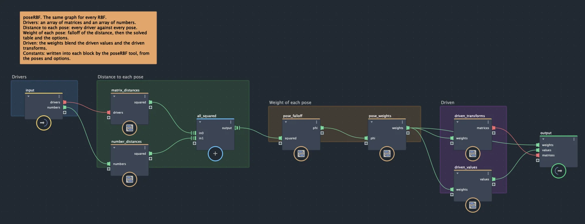
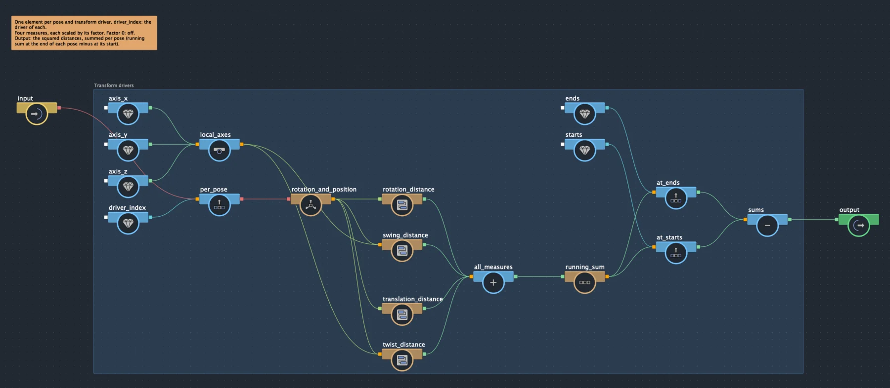
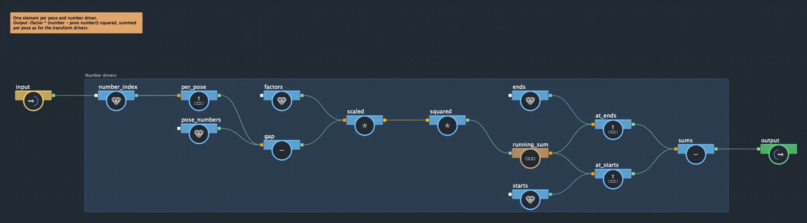
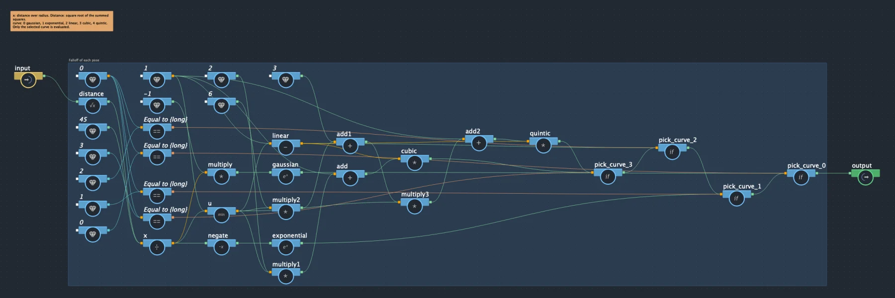
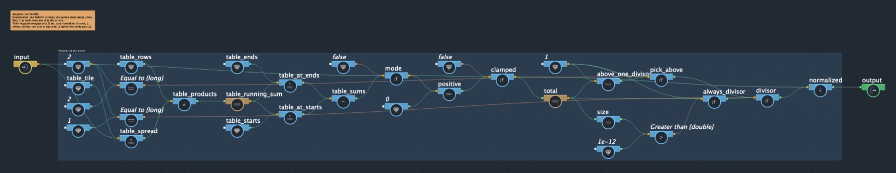
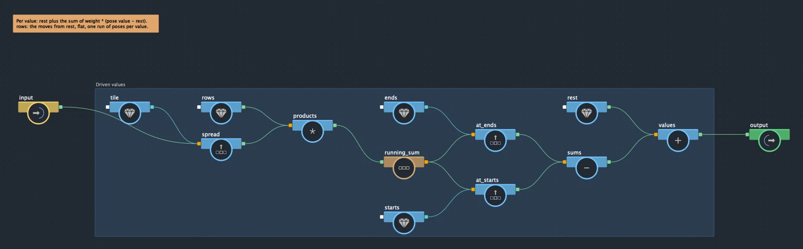
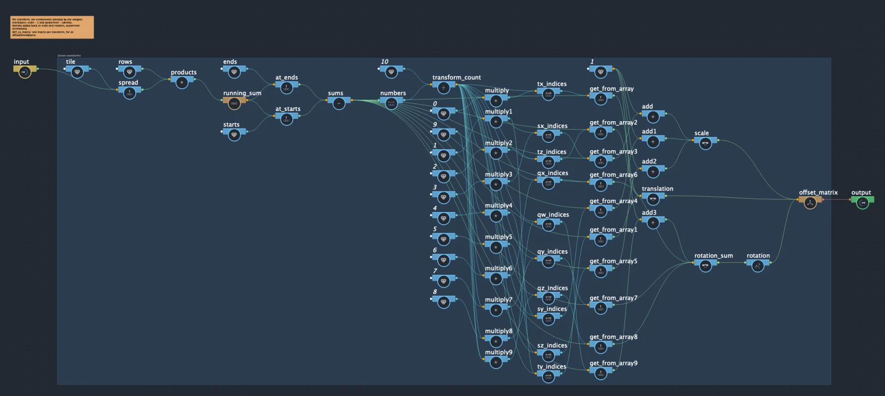

# Inside the board

Each RBF is one Bifrost board with the same graph. Only the drivers enter through ports;
the poses, the solved table and the options are constants, written by the tool.

Every quantity is computed for all the poses at once, with whole arrays and no loops.
Every block carries a note in the Bifrost Graph Editor.

## Distance to each pose

`matrix_distances` compares every transform driver with every pose by the four measures,
each in a compound of its own: rotation, swing, twist and translation. A factor of 0
turns one off. The squares are added per pose.

`number_distances` does the same with the number drivers.

## Weight of each pose

`pose_falloff` takes the square root, divides by the radius and applies the curve.

`pose_weights` multiplies by the solved table, in interpolative mode, cuts the negative
weights and normalizes.

## Driven

`driven_values` adds to rest what each pose asks for, by its weight.

`driven_transforms` blends ten numbers per transform, translation, scale and quaternion,
and makes one matrix of them.

## Undo

Creating an RBF is not undone; deleting it removes it. Every edit is one undo step of
Maya's own: it changes constants and connections, never the graph.
