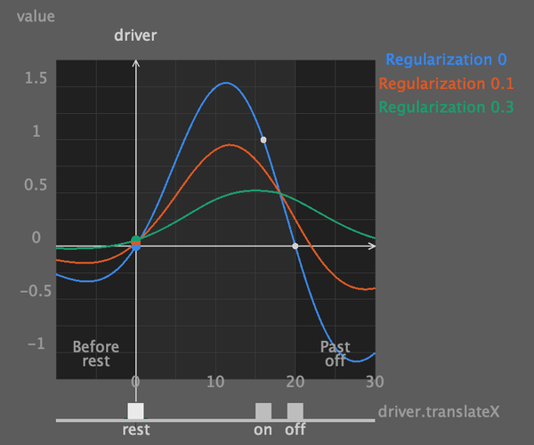
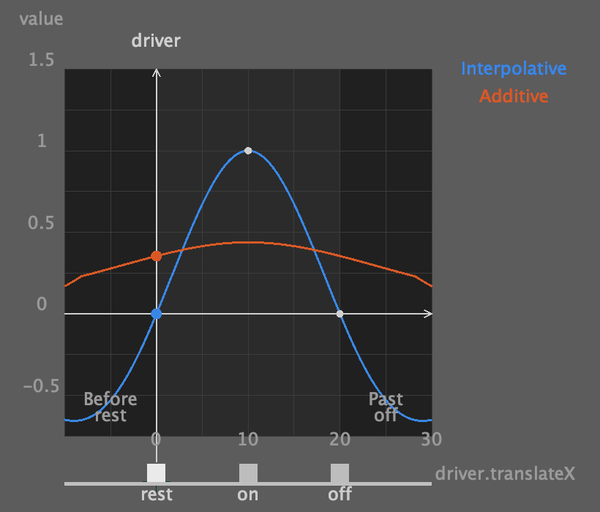

# Calm a value that swings

Two poses close together that ask for opposite things make the value swing between and
past them.

- **Raise the Regularization.** The swing calms down, and the poses are no longer matched
    exactly. In the picture, with `on` asking for 1:

    | Regularization | Value at `on` | Highest value |
    | -------------- | ------------- | ------------- |
    | 0              | 1.00          | 1.54          |
    | 0.01           | 0.99          | 1.52          |
    | 0.1            | 0.73          | 0.95          |
    | 0.3            | 0.52          | 0.52          |

- **Move the poses apart**, or delete the one that is not needed.

- **Choose a narrower curve or a smaller radius**, in the **Options** tab.

## Additive mode

**Additive** does not swing: each pose adds its own curve. It does not reach the poses
exactly either, because they overlap. It suits results that should pile up, not poses
that have to be matched.
