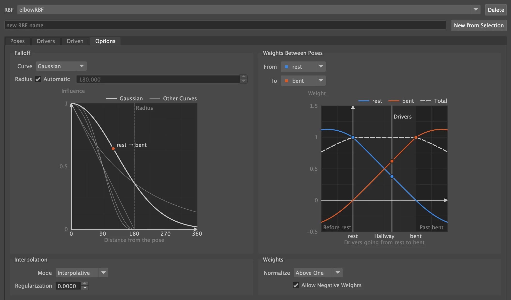
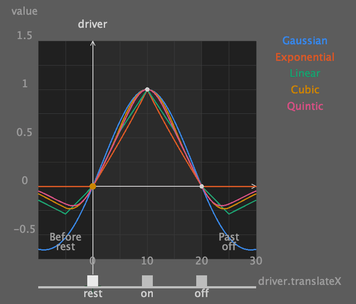
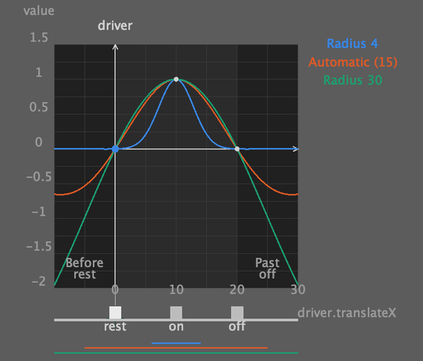

# Choose the curve and the radius

The **Options** tab draws both on the poses of the RBF: on the left, the curve and where
the pose picked lies on it; on the right, the weight of each pose on the way from one to
another.

## Curve

Every curve passes through the poses; they differ in between and past the ends.

| Curve       | In between             | Past the ends           |
| ----------- | ---------------------- | ----------------------- |
| Gaussian    | round, wide            | swings the most         |
| Exponential | pointed at the poses   | stays close to 0        |
| Linear      | straight, with corners | reaches 0 at the radius |
| Cubic       | round, narrower        | reaches 0 at the radius |
| Quintic     | round, the narrowest   | reaches 0 at the radius |

Gaussian is the default. Linear, Cubic and Quintic are exactly 0 past the radius of every
pose.

## Radius

**Automatic** is 1.5 times the average distance from each pose to its nearest one, and
follows the poses as they change. Untick it to type another:

- **Too small:** each pose acts only near itself.
- **Too large:** smooth between the poses, and it swings past them.
