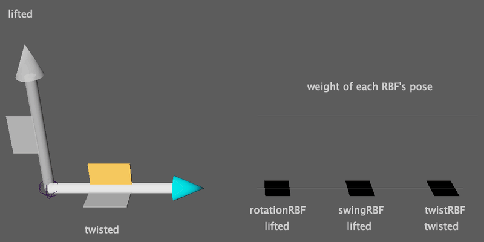
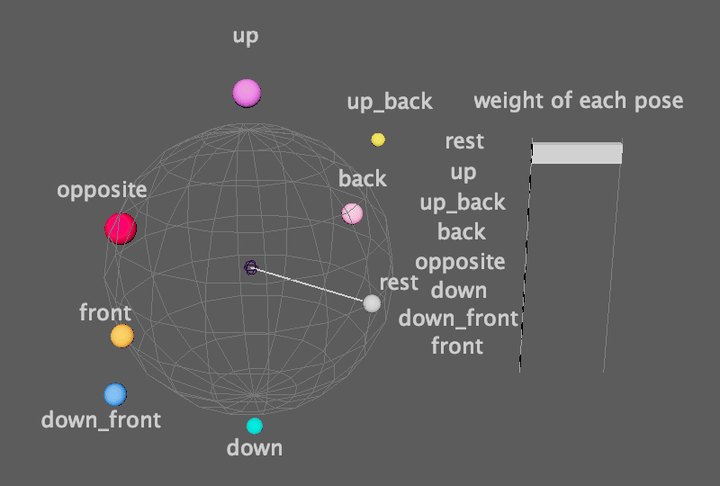

# Choose what is compared

Each driver is compared with the poses by one measure or several. In the **Drivers**
tab, 0 ignores a measure, 1 counts it and 2 counts it double.

| Measure     | Compares                                | Use it for                                 |
| ----------- | --------------------------------------- | ------------------------------------------ |
| Rotation    | the whole orientation, in degrees       | a hinge: an elbow, a knee, a finger        |
| Swing       | where the local axis points, in degrees | a ball joint whose twist should not count  |
| Twist       | the turn about the local axis           | a forearm, a neck                          |
| Translation | the position, in scene units            | a control, a joint that slides             |
| Attribute   | the difference between two numbers      | a slider, an angle already in an attribute |

**Axis** is the local axis of swing and twist: the one that runs along the bone.

Twist is measured from 0 to 180 degrees either way, so a pose at 180 cannot tell one
way from the other.
