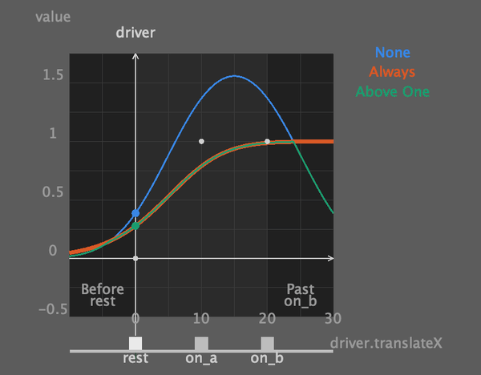
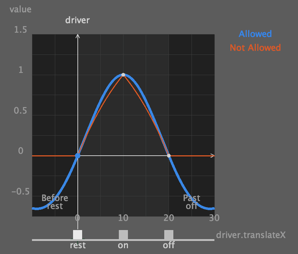

# Keep the weights in check

## The sum

| Normalize     | What it does                                                                       |
| ------------- | ---------------------------------------------------------------------------------- |
| **None**      | Nothing: overlapping poses can add up to more than 1                               |
| **Always**    | The sum is 1 wherever the poses answer: past the last one, the value holds         |
| **Above One** | Only a sum above 1 is divided; far from the poses, it returns to rest. The default |

## Negative weights

Past the last pose an interpolative RBF can push the other way. Untick **Allow Negative
Weights** to cut them at 0; the value also changes a little between the poses.
