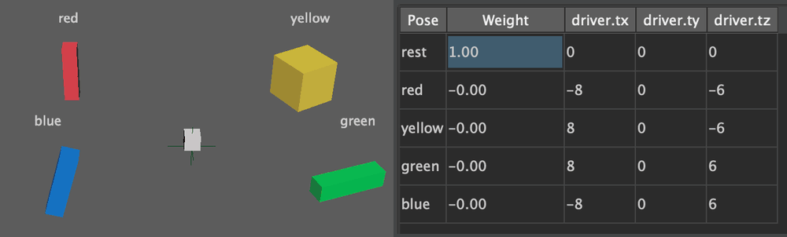

# poseRBF

A pose-space RBF for Autodesk Maya, evaluated by a Bifrost graph. Drivers, joints
and attributes, are compared with example poses, and the weight of each pose blends
what it asks for: attribute values, blendShape weights, joint moves.



It needs Maya 2025, 2026 or 2027 and Bifrost 2.14 or later.

## For riggers

::::{grid} 1 2 2 3
:gutter: 3

:::{grid-item-card} A first corrective
:link: tutorials/first-corrective
:link-type: doc

An elbow from an empty scene, step by step.
:::

:::{grid-item-card} How-to
:link: how-to/index
:link-type: doc

One task per page: drive, pose, smooth, hand over.
:::

:::{grid-item-card} The window
:link: reference/window
:link-type: doc

Every tab, column and menu.
:::

::::

## For developers

::::{grid} 1 2 2 3
:gutter: 3

:::{grid-item-card} A first script
:link: tutorials/first-script
:link-type: doc

The same elbow, from Python.
:::

:::{grid-item-card} Script an RBF
:link: how-to/script-an-rbf
:link-type: doc

Read, change and delete RBFs.
:::

:::{grid-item-card} API
:link: reference/api/poserbf/index
:link-type: doc

Every module, class and function.
:::

::::

## For anyone curious

::::{grid} 1 2 2 3
:gutter: 3

:::{grid-item-card} How an RBF works
:link: explanation/how-it-works
:link-type: doc

From the drivers to the results, with numbers.
:::

:::{grid-item-card} Inside the board
:link: explanation/inside-the-board
:link-type: doc

The Bifrost graph, block by block.
:::

:::{grid-item-card} Limits
:link: explanation/limits
:link-type: doc

What it does not do, and what to expect.
:::

::::

:::{warning}
This project is provided as is, with no support and no warranty. Test it on a
copy before pointing it at anything of value.
:::

```{toctree}
:hidden:
:caption: Learning

tutorials/index
how-to/index
```

```{toctree}
:hidden:
:caption: Looking up

reference/index
```

```{toctree}
:hidden:
:caption: Understanding

explanation/index
```
