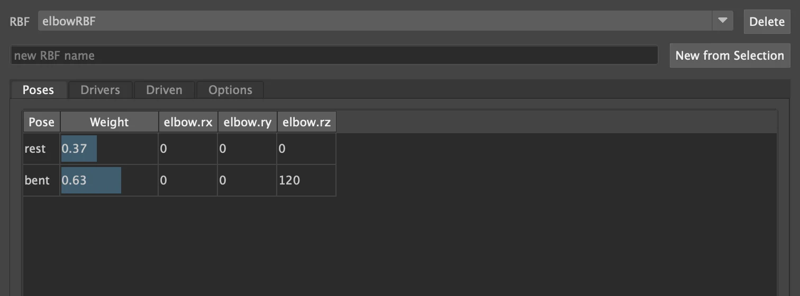
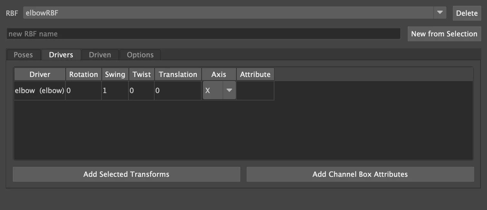
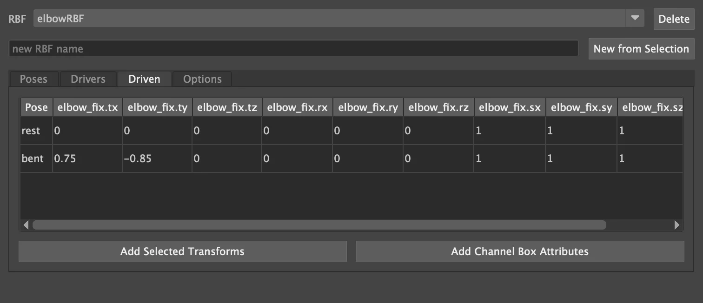
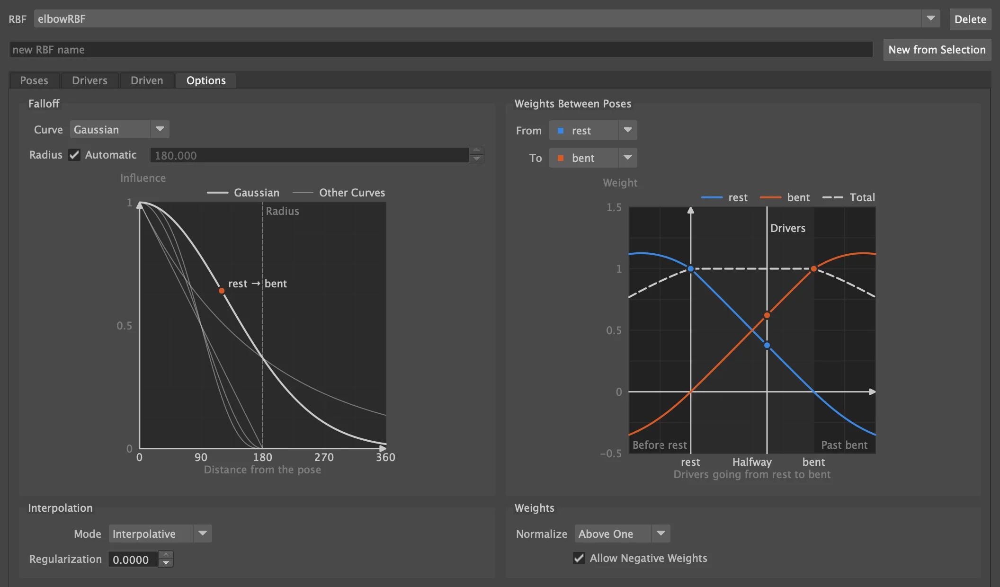

# The window

| Part                   | What it does                                                                                                        |
| ---------------------- | ------------------------------------------------------------------------------------------------------------------- |
| **RBF**                | The RBF shown; every one in the scene is listed                                                                     |
| **Delete**             | Deletes it and returns what it drove to rest                                                                        |
| **new RBF name**       | The name of the next one; `poseRBF` when empty                                                                      |
| **New from Selection** | Creates one driven by the attributes selected in the Channel Box, or by the selected transforms when there are none |

Errors show at the bottom, and nothing changes.

## Poses

| Column          | What it shows                                                       |
| --------------- | ------------------------------------------------------------------- |
| **Pose**        | Its name; a double click edits it                                   |
| **Weight**      | Its weight now, live                                                |
| One per channel | Where the driver was when the pose was taken: the channels compared |

**Add Pose** adds one where the drivers are. The right-click menu is in
[Edit the poses](../how-to/edit-the-poses.md).

## Drivers

| Column          | What it is                                    |
| --------------- | --------------------------------------------- |
| **Driver**      | Its name and its node or attribute            |
| **Rotation**    | How much the whole orientation counts         |
| **Swing**       | How much it counts where the axis points      |
| **Twist**       | How much the turn about the axis counts       |
| **Translation** | How much the position counts                  |
| **Axis**        | The local axis of swing and twist             |
| **Attribute**   | How much a number counts; only for attributes |

0 ignores a measure, 1 counts it and 2 counts it double.

Right-click a driver: **Select**, **Remove**.

## Driven

One column per channel of each driven transform, as a move from its rest, and one per
driven attribute. Every cell can be typed in; a comma is read as the decimal point.

Right-click a header: **Select**, **Remove**. Right-click a row: the menu of the pose.

## Options

| Option                     | Values                                        | Default       |
| -------------------------- | --------------------------------------------- | ------------- |
| **Curve**                  | Gaussian, Exponential, Linear, Cubic, Quintic | Gaussian      |
| **Radius**                 | Automatic, or a distance                      | Automatic     |
| **Mode**                   | Interpolative, Additive                       | Interpolative |
| **Regularization**         | 0 or more                                     | 0             |
| **Normalize**              | None, Always, Above One                       | Above One     |
| **Allow Negative Weights** | On, off                                       | On            |

**From** and **To** pick the poses of the right-hand plot. The vertical line marks where
the drivers are, when they are on the way between the two.
