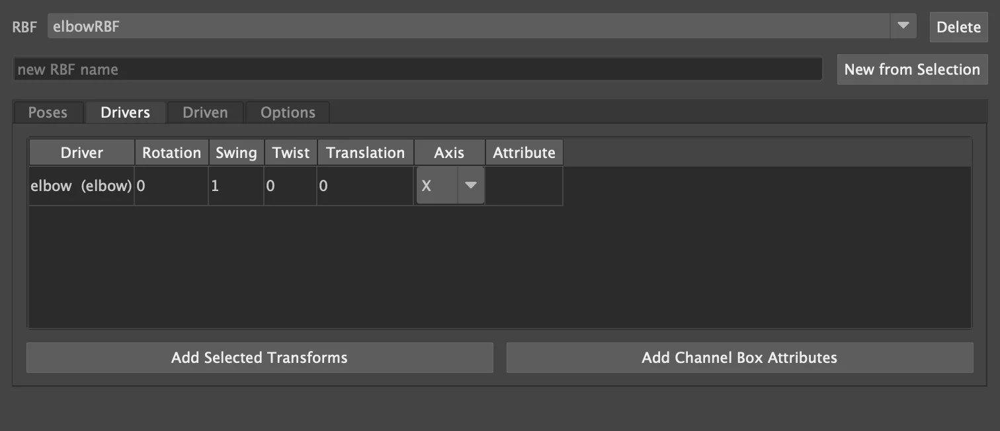
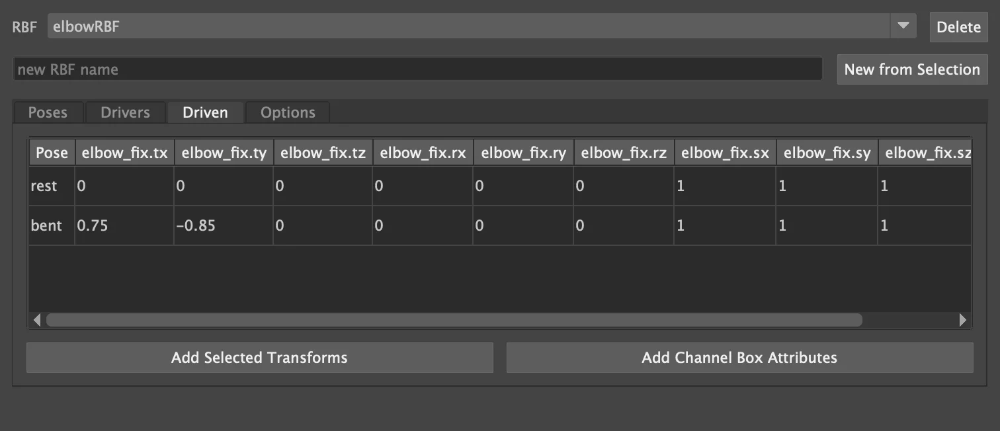
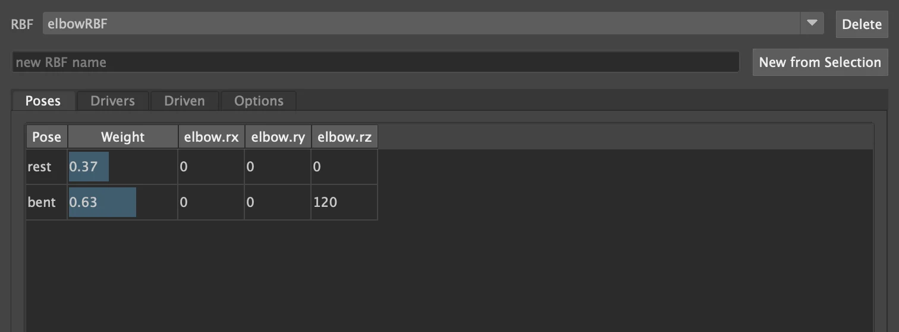

# A first corrective, for riggers

An arm bends and its elbow loses its tip. A corrective joint brings it back: an RBF
reads the elbow and moves the joint only as much as the bend asks for.

It starts from an empty scene and needs poseRBF [installed](../how-to/install.md).

## 1. Make the arm

1. Open a new scene.

2. Open the Script Editor, paste this in a Python tab and run it:

    ```python
    from maya import cmds

    arm = cmds.polyCylinder(
        name="arm",
        radius=1,
        height=10,
        axis=(1, 0, 0),
        subdivisionsX=24,
        subdivisionsY=40,
        constructionHistory=False,
    )[0]
    cmds.move(5, 0, 0, arm)
    cmds.select(clear=True)
    shoulder = cmds.joint(name="shoulder", position=(0, 0, 0))
    elbow = cmds.joint(name="elbow", position=(5, 0, 0))
    cmds.joint(name="wrist", position=(10, 0, 0))
    cmds.select(shoulder)
    fix = cmds.joint(name="elbow_fix", position=(5, -1, 0))
    cmds.skinCluster(
        shoulder,
        elbow,
        fix,
        arm,
        toSelectedBones=True,
        maximumInfluences=3,
        dropoffRate=4,
    )
    ```

    A cylinder appears, skinned to `shoulder`, `elbow` and `elbow_fix`. The last one
    is the corrective joint; it sits under the elbow.

3. Set `elbow.rotateZ` to 120 in the Channel Box. The forearm lifts and the tip of
    the elbow flattens. Set it back to 0.

## 2. Make the RBF

1. Click **poseRBF** on the shelf. The window opens.

2. Select `elbow`, type `elbowRBF` in **new RBF name** and click **New from
    Selection**.

    The **Poses** tab shows one pose, `rest`, with a weight of 1.00: the arm as it is
    now.

3. Open the **Drivers** tab. In the row of `elbow`, type 0 under **Rotation** and 1
    under **Swing**.

    

    The elbow is now compared by where it points. Its twist no longer counts.

4. Open the **Driven** tab, select `elbow_fix` and click **Add Selected
    Transforms**.

    Nine columns appear, one per channel of the joint.

## 3. Add the pose

1. Set `elbow.rotateZ` to 120.

2. In the **Poses** tab, click **Add Pose**. A second row appears, `pose1`, with a
    weight of 1.00.

3. Double-click its name, type `bent` and press Enter.

4. Select `elbow_fix` and, in the Channel Box, set its **Translate X** to 5.75 and
    its **Translate Y** to -1.85. The tip of the elbow comes back.

5. Right-click `bent` and click **Update Driven**.

    The channels of `elbow_fix` go back to 5 and -1, and the joint stays where it was:
    the RBF moves it now. The **Driven** tab shows the move of the pose.

    

## 4. See it work

Set `elbow.rotateZ` to 0, 40, 80 and 120. The joint follows the bend, and the **Poses**
tab shows how much each pose weighs.



## Next

- [Drive joints](../how-to/drive-joints.md), [blendShapes and
    attributes](../how-to/drive-blendshapes-and-attributes.md).
- [Use several drivers](../how-to/use-several-drivers.md) for one pose.
- [How an RBF works](../explanation/how-it-works.md).
